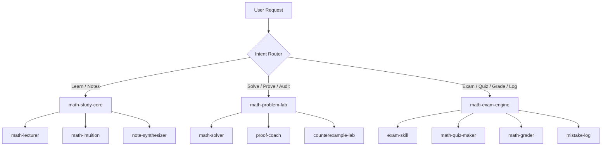

# math-skills

A modular, token-efficient suite of university-level mathematics agent skills covering concept learning, rigorous proof coaching, verified problem solving, Obsidian synthesis, rubric-based grading, mistake tracking, and exam strategy.

## Architecture

To minimize context overhead (~70% token reduction per session) and maximize routing accuracy, the 10 specialized modes are grouped into **3 focused skill packages** with lazy-loaded reference files:



### Skill Packages

| Package | Modes | Purpose | Lazy-Loaded References |
| :--- | :--- | :--- | :--- |
| **`math-study-core`** | `math-lecturer`, `math-intuition`, `note-synthesizer` | Formal lecture walkthroughs, intuition-first rebuilds with toy models, and Obsidian Markdown synthesis. | None (self-contained) |
| **`math-problem-lab`** | `math-solver`, `proof-coach`, `counterexample-lab` | Verified full solutions, non-spoiler Socratic proof coaching, and minimal counterexamples. | `verification.md`, `proof-patterns.md`, `counterexamples-by-area.md` |
| **`math-exam-engine`** | `exam-skill`, `math-quiz-maker`, `math-grader`, `mistake-log` | Past-exam/syllabus filtering, original practice quizzes, 100-pt rubric grading, and spaced mistake logs. | `rubrics.md`, `error-taxonomy.md`, `log-template.md`, `verification.md` |

## Core Guarantees

- **Automatic Language & Terminology Matching:** Matches the user's input language automatically. When writing in Turkish, technical mathematical terms are preserved in English or introduced in parentheses (e.g., *bölüm uzayı (quotient space)*). Obsidian notes default to formal English.
- **Zero Unchecked Claims:** Every computation, counterexample, or reference solution is verified via code execution or an independent second method before output.
- **Strict Hypothesis & Cutoff Discipline:** Never drops hidden conditions (finite dimensionality, $\operatorname{char}(F) \neq 2$, compactness) or uses techniques beyond the stated topic cutoff.
- **Cross-Package State Carry-Over:** Seamlessly inherits active theorems, proof attempts, deductions, and notation when transitioning across modes in the same session.

## Installation

### 1. Clone the repository
```bash
git clone https://github.com/<your-username>/math-skills.git
cd math-skills
```

### 2. Install modular skills (Recommended)
Run the installer script to copy the 3 skill packages into your agent skills directory (defaults to `~/.agents/skills`):
```bash
chmod +x install.sh
./install.sh
```
Or specify a custom target directory:
```bash
./install.sh /path/to/your/skills/dir
```

### 3. Single-Prompt Build (Optional)
For platforms that only accept a single system prompt file without multi-file skill directories:
```bash
python3 scripts/build_all_in_one.py
```
This generates `dist/ALL_IN_ONE_PROMPT.md` combining all 3 skill packages and reference tables.

## License

MIT
