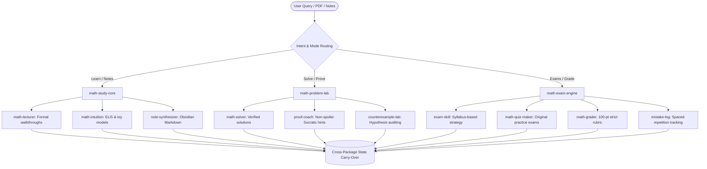

# math-skill

A modular, token-efficient suite of university-level mathematics agent skills covering concept learning, rigorous proof coaching, verified problem solving, Obsidian synthesis, rubric-based grading, mistake tracking, and exam strategy.

---

## Architecture



### Module Overview

| Package | Modes | Core Function | Supplementary Files |
| :--- | :--- | :--- | :--- |
| **`math-study-core`** | `math-lecturer`, `math-intuition`, `note-synthesizer` | Rigorous lectures, intuition-first rebuilds, and Obsidian Markdown notes with YAML & Mermaid maps. | `obsidian_template.md`, `pedagogy.md` |
| **`math-problem-lab`** | `math-solver`, `proof-coach`, `counterexample-lab` | Verified step-by-step solutions, Socratic proof hints, and minimal counterexamples. | `verification.md`, `proof_patterns.md` |
| **`math-exam-engine`** | `exam-skill`, `math-quiz-maker`, `math-grader`, `mistake-log` | Exam strategy, mock exams, 100-pt rubric grading, and spaced mistake logs. | `template.md`, `verification.md` |

---

## Core Guarantees

* **Automatic Language & Terminology Matching:** Matches the user's input language automatically. When writing in Turkish, technical mathematical terms are preserved in English or introduced in parentheses (e.g., *bölüm uzayı (quotient space)*). Obsidian notes default to formal English.
* **Zero Unchecked Claims:** Every computation, counterexample, or reference solution is verified via code execution or an independent second method before output.
* **Strict Hypothesis & Cutoff Discipline:** Never drops hidden conditions (finite dimensionality, $\mathrm{char}(F) \neq 2$, compactness) or uses techniques beyond the stated topic cutoff.
* **Cross-Package State Carry-Over:** Seamlessly inherits active theorems, proof attempts, deductions, and notation when transitioning across modes in the same session.

---

## Installation

### Option 1: Gemini Web UI / Gems (Zero Terminal Setup)
For users who want to use this suite directly in Google Gemini without Git or CLI tools:

1. Generate or download the combined all-in-one Markdown file (`python3 build_all_in_one.py`).
2. Open [Gemini](https://gemini.google.com) and navigate to **Gem Manager -> New Gem**.
3. Paste the file content into the **Instructions** field (if the text exceeds the character limit, upload the `.md` file to **Knowledge** and write `"Follow the modular math skill instructions in the attached file."` in Instructions).
4. Save and start your session.

### Option 2: CLI & Agent Skill Frameworks (Modular)

#### 1. Clone the repository
```bash
git clone https://github.com/ilhanskywalker/math-skill.git
cd math-skill
```

#### 2. Install modular skills (Recommended)
```bash
chmod +x install.sh
./install.sh
```

#### 3. Build single-file bundle (Optional)
If your LLM client only supports a single system prompt file:
```bash
python3 build_all_in_one.py
```

---

## Usage Examples

* **Lecture & Intuition:** *"Walk me through the First Isomorphism Theorem for groups using `math-lecturer`, then give me a toy model via `math-intuition`."*
* **Obsidian Notes:** *"Convert my attached Real Analysis PDF into structured Obsidian notes using `note-synthesizer`."*
* **Proof Coaching:** *"Here is my proof attempt for compactness of $[a,b]$. Check for gaps using `proof-coach` without spoiling the solution."*
* **Counterexample Audit:** *"True or False: Every continuous bijection is a homeomorphism. Audit this with `counterexample-lab`."*
* **Grading & Mistake Tracking:** *"Grade my midterm solution out of 100 with `math-grader` and append my errors to `mistake-log`."*

---

## License

This project is licensed under the [MIT License](LICENSE).
